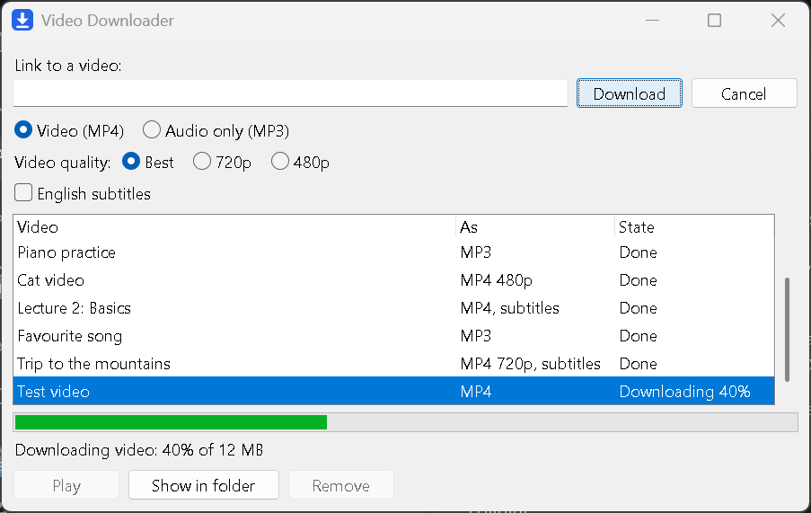

# video-downloader

A small Windows app: paste a link to a video and it saves the video to your PC as MP4, or just the audio as MP3, showing progress as it goes. It is a simple window on top of [yt-dlp](https://github.com/yt-dlp/yt-dlp), which does the actual downloading and supports thousands of sites.

It does not download from DRM-protected services (Netflix, Disney+, Spotify and the like).



## Status
Downloading works, and when a download fails the window says why in plain words. Reddit works once you've signed in ([Signing in](docs/signing-in.md)). What changed in each version is in [CHANGELOG.md](CHANGELOG.md), what comes next in [docs/todo.md](docs/todo.md).

## Using it
Paste a link, choose **Video (MP4)** or **Audio only (MP3)** and, for a video, its quality (Best, 720p or 480p) and whether you want English subtitles, then press Download (or Enter).
- Paste more links while one downloads: they wait in the list and download one after another, each with the choices it was added with.
- A link to a playlist or channel downloads all its videos, into a folder named after it.
- The list also shows what you downloaded before (the newest 200), so you can play an earlier download again.
- Files go to the **Videos** folder inside your Downloads folder: MP4s that play everywhere (H.264 video with AAC sound), or MP3s.
- Click a row in the list to see its progress or message. **Play** and **Show in folder** open its file, **Remove** takes it out of the list (never deletes a file), and **Cancel** stops the running download.
- When a download fails, the window says why in plain words. Reddit needs a sign-in file: see [Signing in](docs/signing-in.md).
- A button in Chrome downloads the video on the page you're on, as MP4 or MP3, without leaving Chrome, and can cancel it again: see [The Chrome button](docs/using.md#the-chrome-button).

Everything in detail: [Using the app](docs/using.md).

## Install and run
Needs Windows, [ffmpeg](https://ffmpeg.org) and [Deno](https://deno.com). You build the installer yourself, which needs Python 3.13 and [Inno Setup](https://jrsoftware.org/isinfo.php). All commands are for PowerShell, in the project folder.

Get the project first: on its GitHub page, **Code > Download ZIP**, then extract it (or `git clone` it), and open its folder in PowerShell.

1. Install ffmpeg (yt-dlp's own build, which patches some ffmpeg bugs that affect yt-dlp), Deno, Inno Setup and Python 3.13:
   ```powershell
   winget install --id yt-dlp.FFmpeg -e
   winget install --id DenoLand.Deno -e
   winget install --id JRSoftware.InnoSetup -e
   winget install --id Python.Python.3.13 -e
   ```
   Then restart VS Code (or your terminal) so it sees the new programs.
2. Create the virtual environment and install the app's code with its tools:
   ```powershell
   py -3.13 -m venv .venv
   .venv\Scripts\Activate.ps1
   python -m pip install -e ".[dev]"
   ```
   If PowerShell says "running scripts is disabled on this system", allow scripts for your account once with `Set-ExecutionPolicy -Scope CurrentUser RemoteSigned`, then run the last two lines again.
3. Build the installer (it takes a few minutes, and updates yt-dlp first):
   ```powershell
   python installer/build.py
   ```
4. Run `dist\Video Downloader Setup.exe`. It installs the app for your account only (no admin rights needed), adds it to the Start menu and starts it. The app has only one window: starting it again brings the open one to the front.
5. Optional, the Chrome button: load the installed app's `extension` folder in Chrome. Step by step: [The Chrome button](docs/using.md#the-chrome-button).

The installed app keeps yt-dlp up to date by itself (needed now and then when YouTube changes): it fetches a newer version in the background, and the window says when one is ready, with a button to restart the app and use it. To uninstall, use Settings > Apps; your history and sign-in file stay. More: [Installing and updating](docs/using.md#installing-and-updating).

## Development
Run the app straight from the project, with the `.venv` active: `python -m video_downloader` (with a link after it, the link goes into the open window's box). The Chrome button then needs `python -m video_downloader.browser install`, which points Chrome at the project's helper instead of the installed one ([The Chrome button](docs/using.md#the-chrome-button)). Updating yt-dlp here: `python -m pip install -U "yt-dlp[default]"`. To check that yt-dlp finds ffmpeg and Deno, run `yt-dlp -v`: the `exe versions` line should list ffmpeg and the `JS runtimes` line deno; the closing "You must provide at least one URL" is expected.

Checks, with the `.venv` active: `ruff check .` and `ruff format .` (lint and formatting), `pytest` (tests), `pyright` (type check).

`pytest` needs ffmpeg for the download tests: they download a 1-second clip from a small web server they start on this PC (never the internet). Without ffmpeg they are skipped.

The build: `python installer/build.py` updates yt-dlp, builds the app into `dist\Video Downloader\` (`Video Downloader.exe` there starts it without installing) and makes `dist\Video Downloader Setup.exe` from it. `--no-update` leaves yt-dlp as it is.

GUI test: `pytest tests/gui/window_gui.py` (about 45 seconds) opens the real window, types a link, presses Enter and clicks Download, and checks what the window shows; a fake download stands in for yt-dlp. Screenshots: `python tests/gui/screenshots.py` (or one screen by name, e.g. `done`) saves them to the temp folder and prints the paths. Both open the window on top, on another screen if there is one, and don't take your keyboard; keys and clicks in their window are ignored. How they work: [docs/research/gui-testing.md](docs/research/gui-testing.md). The Chrome button's popup has its own test, `pytest tests/gui/popup_gui.py`, which needs Chrome and shows nothing on screen.

## Credits
- [yt-dlp](https://github.com/yt-dlp/yt-dlp) by the yt-dlp contributors, Unlicense: does all the downloading.
- The libraries yt-dlp installs with it, which the built app includes, each by its own authors: [requests](https://github.com/psf/requests) (Apache 2.0), [urllib3](https://github.com/urllib3/urllib3) (MIT), [certifi](https://github.com/certifi/python-certifi) (MPL 2.0), [mutagen](https://github.com/quodlibet/mutagen) (GPL 2.0 or later), [pycryptodomex](https://github.com/Legrandin/pycryptodome) (BSD and public domain), [brotli](https://github.com/google/brotli) (MIT), [websockets](https://github.com/python-websockets/websockets) (BSD 3-Clause), [idna](https://github.com/kjd/idna) (BSD 3-Clause) and [charset-normalizer](https://github.com/jawah/charset_normalizer) (MIT).
- [FFmpeg](https://ffmpeg.org) by the FFmpeg developers, LGPL 2.1+ or GPL 2+ depending on the build (the suggested [yt-dlp build](https://github.com/yt-dlp/FFmpeg-Builds) is GPL): joins video and audio, converts to MP3 and converts subtitles to SRT.
- [yt-dlp-ejs](https://github.com/yt-dlp/ejs) by Simon Sawicki and the yt-dlp contributors, Unlicense with bundled MIT and ISC parts: installed with yt-dlp, solves YouTube's JavaScript challenges together with Deno.
- [Deno](https://deno.com) by the Deno authors, MIT: the JavaScript runtime yt-dlp needs for YouTube.
- [Get cookies.txt LOCALLY](https://github.com/kairi003/Get-cookies.txt-LOCALLY) by kairi003, MIT: a browser extension, not part of the app, for exporting Reddit's sign-in ([Signing in](docs/signing-in.md)).
- [Python](https://www.python.org) and tkinter by the Python Software Foundation, PSF License (tkinter uses [Tcl/Tk](https://www.tcl-lang.org), BSD-style license): the app and its window.
- [PyInstaller](https://pyinstaller.org) by the PyInstaller Development Team, GPL 2.0 with an exception for the programs it builds: builds the app's .exe files.
- [Inno Setup](https://jrsoftware.org/isinfo.php) by Jordan Russell and Martijn Laan, Inno Setup License (free, also for commercial use): makes the installer.
- Development tools: [ruff](https://github.com/astral-sh/ruff) by Astral (MIT), [pyright](https://github.com/microsoft/pyright) by Microsoft (MIT), [pytest](https://pytest.org) by the pytest-dev team (MIT), [Pillow](https://python-pillow.github.io) by Jeffrey A. Clark and contributors (MIT-CMU, screenshots for the GUI test; drew the Chrome button's icons and makes the .exe files' icon), [hatchling](https://github.com/pypa/hatch) by the Python Packaging Authority (MIT, builds the package for the install).

## License
MIT: see [LICENSE](LICENSE).
